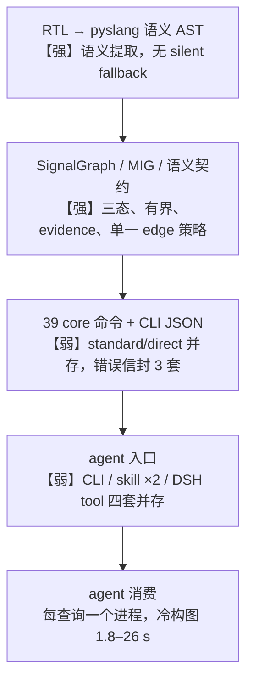

# 面向 agent 的设计与整体结构评审 — 建议稿

> **文档版本**: v1.0（初稿）
> **评审时间**: 2026-11-16 20:05 CST (GMT+8)
> **评审对象版本**: git HEAD `2a004f76`（`fix(P181): reset suffixes/sized literals, virtual class, shared shift`，2026-11-16T20:00:17+08:00），评审时 worktree clean
> **对外契约版本**: `capabilities.json_contract.schema_version = "1"`；命令面 39 core + 6 exp
> **测试基线**: 见 [INDEX 当前基线](../INDEX.md)（评审时登记为 canonical 2770 passed / 0 failed，2026-11-16 P181 复核）；**本评审未运行任何测试或门禁**
> **评审方式**: 只读静态阅读（产品/契约/流程文档 + `src/` 代码实现 + `tools/` 门禁与 agent 设施）；**未修改任何项目文件**
> **状态**: 讨论底稿 / 建议稿。**不是**已登记计划、**不是**已批准任务、**不是**权威契约。

---

## 0. 给后续 agent 的阅读须知（先读这一节）

1. **本文是什么**：一次只读评审的观察、判断与候选改善建议。目的是让下一个 agent 快速理解"面向 agent 的设计哪里强、哪里弱"，而不是让它照着改代码。
2. **本文不是什么**：
   - 不是计划。全局唯一计划源是 [PLAN.md](../../PLAN.md)；本文的 `R-*` 编号**仅用于本文索引**，与 PLAN 的 `P*` 编号无关，也不是待办列表。
   - 不是契约。语义以 [SEMANTIC_CONTRACTS](../dev/SEMANTIC_CONTRACTS.md)、[CLAIMS](../dev/CLAIMS.md)、`sv_query capabilities --json` 为准。
   - 不是命令面真相源。命令/字段/错误码一律以运行时 `capabilities --json` 为准，不要照抄本文列举的命令名或字段名。
   - 采纳任何建议前，必须按 `AGENTS.md §2` 先登记 PLAN、置 current item、建任务文档；**不要直接据本文动手**。
3. **标注约定**：
   - `【事实】` = 静态阅读代码/文档可直接核实的陈述，附路径；
   - `【判断】` = 基于事实的评审推断，可能随设计取舍变化；
   - `【建议】` = 未采纳的候选方案，需要方豆拍板。
4. **时点性**：所有【事实】绑定 `2a004f76`。代码继续演进后（尤其 P181 后续提交），结论可能失效；请用 §8 的复核命令重新核对，不要凭本文的记忆继续工作。
5. **计数口径**：文中的 1051 / 519 / 656 / 39 / 6 / 1100 行等数字都是 2026-11-16 的静态统计，不是承诺值。

---

## 1. 一句话结论

> **这个项目的"事实层"设计得比"交付层"好得多。**
> 防幻觉的数据契约是同类工具里少见的扎实；但把事实交给 agent 的那一层（JSON 信封、schema、入口、会话模型）恰好最薄弱，而且被极重的流程治理掩盖了。

补充判断（针对 [arch_eval_2026-11-11](arch_eval_2026-11-11.md) 的结论）：同意"方向正确、不需要推倒重来"；但它没有说透的一点是——**当前最大风险不是解析精度或性能，而是"承诺给 agent 的稳定契约"并没有被机器保证**；治理强度与接口强度严重不匹配。

结构链路与强弱分布（评审视角，非代码生成物）：



---

## 2. 评审范围与证据来源

| 类别 | 读过的内容 |
|---|---|
| 产品/流程 | [product_direction_2026-10-31](product_direction_2026-10-31.md)、[PLAN.md](../../PLAN.md)、`CURRENT_TODO.md`、`AGENTS.md`、[DISCIPLINE](../dev/DISCIPLINE.md)、[SEMANTIC_CONTRACTS](../dev/SEMANTIC_CONTRACTS.md)、[CLAIMS](../dev/CLAIMS.md)、[INDEX](../INDEX.md)、[HANDOFF](../dev/HANDOFF.md) |
| 契约/agent | [json_contract_2026-10-31](json_contract_2026-10-31.md)、[AGENT_FEATURE_MAP](../agent/AGENT_FEATURE_MAP.md)、[CLI_SURFACE](../CLI_SURFACE.md)、`skills/sv-query/SKILL.md`、`tools/llm_schema.json`、`tools/agent/README.md`、`tools/agent/svq_query.patch.yml` |
| 实现 | `src/cli/`（`main.py` / `_registry.py` / `_output.py` / `errors.py` / `_common.py` / `core/semantic/*`）、`src/sv_query/trace/`（`unified_tracer.py` / `core/pipeline.py` / `core/builder/graph_pipeline.py` / `core/graph/contracts.py` / `core/cache/ast_cache.py` / `core/snapshot_manager.py`） |
| 验证/门禁 | `tools/run_gates.sh`、`tools/check_cli_layers.py`、`tools/check_docs.py`、`docs/validation/` 下 P158 / P180 / P181 相关评审、`docs/validation/QUERY_PERF_2026-11-04.md`、`docs/validation/QUERY_COST_ATTRIBUTION_2026-11-07.md`、`README.md` 的对照实验章节 |

---

## 3. 好的设计

### 3.1 面向 agent

| # | 观察 | 证据 |
|---|---|---|
| G-A1 | **把"防幻觉"从 prompt 下沉成数据契约**。`verified / contradicted / unknown` 是状态机而非形容词；verified 必须同时满足"检查全执行 + 覆盖完整 + 无 unknown + 0 violations + 证据链完整"，sample/truncated 只能给 partial/unknown | `SEMANTIC_CONTRACTS §4`；`src/cli/core/semantic/verify.py` 的 `coverage_complete` 聚合 |
| G-A2 | **"没查完"与"没有"严格区分**：`not_found` 只在完整搜索后使用，预算耗尽是 `unknown`；`cycles_detected:null` 不是"无环"；`stage:null + stage_known:false` 不是 stage 0；路径枚举带 work budget + deadline + `truncated` + `truncation_reason`（SPI 7.6k 节点从 >30 s 无输出变为 0.6 s truncated） | `SEMANTIC_CONTRACTS §3/§4`；`graph/search_budget.py`；`docs/validation/P158_REMEDIATION_2026-11-11.md` |
| G-A3 | **可发现 + 降级显式**：`capabilities --json` 是运行时命令面真相源（39 core / 6 exp，带 `mode/cost/recommended/envelope/write_scope/schema_version`）；exp 默认隐藏且不承诺契约；SKILL.md 明写"不要相信文档里的旧命令列表" | `src/cli/_registry.py` 的 `COMMANDS`/`to_json()`；`src/cli/core/locate/capabilities.py`；`skills/sv-query/SKILL.md:12` |
| G-A4 | **证据链与诚实度**：per-driver / per-hop `file:line`；20 条 claim ledger 带 `verified/scoped/unverified/known-broken`；独立 Verilator oracle + mutation gate 20/20；`KNOWN_LIMITATIONS` 登记真实反例；"worker APPROVE 不是证据"写进契约 | `CLAIMS.md`；`tools/agent/verilator_oracle.py`；`tools/run_mutation_gate.py`；`SEMANTIC_CONTRACTS §8/§10` |
| G-A5 | **结论不越界**：12 题双模型对照 svq 48/48 vs source 32/48，README 自己标注"direct structural query，不是 debug reasoning；token 未拆分；不宣称外部准确率" | `README.md` "Agent 对照（内部，2026-11-07）" |
| G-A6 | **只读与写入安全**：core 不碰 RTL；`filelist prune` 默认 dry-run + `--apply` + `.bak` + 后缀白名单；snapshot 只写 cache 目录；用目录指纹测试证明只读 | `DISCIPLINE §0` I1；`SEMANTIC_CONTRACTS §6`；`src/cli/core/locate/filelist_cmd.py` |

### 3.2 整体结构

| # | 观察 | 证据 |
|---|---|---|
| G-S1 | **依赖方向干净**：CLI → engine 79 处 import，engine 反向零真实 import、无 argparse/typer；业务 stdout JSON 全收敛在 CLI 侧 | `src/cli/**` vs `src/sv_query/trace/**` 静态检索 |
| G-S2 | **纪律被机械化**：`check_cli_layers.py` R1~R9（层方向、core 必须 `--json`、禁止写文件、builtin 遮蔽、路径锚点、输出 helper 收敛）；`run_gates.sh` 单一 canonical gate 且 CI 同款；"规则没有对应检查器就只能叫 guideline"这条元规则很成熟 | `tools/check_cli_layers.py`；`tools/run_gates.sh`；`DISCIPLINE §0.1` |
| G-S3 | **声明式 DAG**：`build_graph` 11 步 + `GraphBuilder` 12 pass 用 inputs/outputs、requires/provides 拓扑排序，非法依赖立即 `ValueError`，新增步骤有明确插入点 | `src/sv_query/trace/core/pipeline.py`；`src/sv_query/trace/core/builder/graph_pipeline.py`；`unified_tracer.py` |
| G-S4 | **唯一真相源被显式治理**：PLAN（全局唯一计划树）、GLOSSARY、SEMANTIC_CONTRACTS、CLAIMS、INDEX 各有机械校验；`graph/contracts.py` 把 edge 三分类定为唯一策略并配 mutation 测试 | `tools/check_plan.py` / `check_docs.py`；`sim/tests/unit/test_p158_data_edge_contract.py` |
| G-S5 | **减法做得比加法好**：不做波形值、不 inline 函数、不做全设计图；coverage/typo 单开项目；项目适配外置 boundary map 且强制 `proven:false` | `product_direction §4`；`docs/dev/PROJECT_ADAPTATION.md` |

---

## 4. 不好的设计

### 4.1 面向 agent（问题集中在交付层）

| # | 观察 | 证据 |
|---|---|---|
| B-A1 | **"稳定 schema"目前是人工约定，不是可执行契约**。`_registry.py` 约 1100 行 `JSON_CONTRACT` 是 Python dict + 字符串标签（`"type": "string|null"`），没有 `required/properties/$ref`，**没有任何校验器消费它**；真正的 JSON Schema `tools/llm_schema.json` 只覆盖 5 个旧别名命令、版本 `1.2.0` ≠ `"1"`、HANDOFF 承认已漂移、不在任何 gate 里。agent 能选命令，不能自动生成请求或校验响应 | `src/cli/_registry.py:351+`；`tools/llm_schema.json`；`tools/llm_schema_validate.py`；`docs/dev/HANDOFF_2026-11-12.md` |
| B-A2 | **输出形状在最容易误读的地方分裂**：standard envelope 与 11 类 direct 并存（`snapshot list` 顶层是数组、连 `ok` 都没有）；`errors[]` 是 `string\|object` union；失败信封 3 套（`_output.fail` / `errors.make_error` / `_common.emit_json_error`，`error` 有时是字符串有时是对象）；exit code 与 `ok` 不一致——批量部分失败 `ok:false` 却 rc=0；缺参数 rc=1 却完全不输出 JSON；`diagnose` 有 rc=2。**`AGENT_FEATURE_MAP` 用 862 行教 agent "先探测形状"，这本身就是契约失败的度量** | `src/cli/core/semantic/trace.py:653,705`；`src/cli/main.py:153,198,215`；`src/cli/_output.py`；`src/cli/errors.py`；`docs/agent/AGENT_FEATURE_MAP.md:646-660` |
| B-A3 | **四套 agent 入口并存且互相冲突**：CLI+文档、`skills/sv-query`、`.dsh` skill、DSH 专有 `svq_query` tool（8 intents、snapshot-only、单信号）；patch 甚至禁用 `tool-skill`。项目自己的实测显示**接口收敛比文档说教有效**（受限工具 48/48、wall 63.5s→9s），但它被当作评测装置，不是产品。于是 "agent 一等公民" 没有一等入口 | `tools/agent/svq_query.patch.yml`；`tools/agent/README.md`；`docs/validation/TOOL_PILOT_12_2026-11-08.md`；`docs/architecture/AI_REQUIREMENTS.md` |
| B-A4 | **会话模型与迭代式工作流不匹配**：产品方向写明 debug 是"多批次、逐步追问"，实现却是每查询一个进程——36 处 `build_graph()` 无缓存 vs 4 处带 `use_cache`；冷构图 picorv32 1.8 s / verilog-axi 26 s；`--from-snapshot` 仅覆盖约 10 个命令，scope/params/controlflow/profile 仍需 `--filelist`。`arch_eval` 方案 C（常驻服务）推荐过，决策记录仍是"现在不做 serve / batch" | `src/sv_query/trace/unified_tracer.py:300`（`use_cache=False` 默认）；`docs/validation/QUERY_PERF_2026-11-04.md`；`docs/validation/QUERY_COST_ATTRIBUTION_2026-11-07.md`；`product_direction §6` P2 |
| B-A5 | **图完整性与 `ok` 脱钩**：`stats` 里 `ok:true, errors:[]` 是硬编码，即使 `result.elaboration_errors` 非空。agent 只看 `ok` 就会拿一张不完整图继续推理，与"失败必须显式"的铁律直接矛盾 | `src/cli/main.py:198,215` |
| B-A6 | **文档/技能对齐靠人肉**：`check_docs.py` 只查死链/登记/计数，不校验命令可运行或字段与 capabilities 一致；P175→P177 三轮 skill review 反复 FAIL，P180/P181 还在修文档与输出不一致。skill 让 agent "别信文档"，文档却是唯一使用说明，形成闭环矛盾 | `tools/check_docs.py`；`docs/validation/P180_WORKER_REVIEW_2026-11-16.md`；`docs/validation/P181_DISCIPLINE_REMEDIATION_2026-11-16.md`；`docs/CLI_COMMAND_CHEATSHEET.md:3` |

### 4.2 整体结构

| # | 观察 | 证据 |
|---|---|---|
| B-S1 | **治理体积压过代码**：docs 1051 个 .md、519 份 iter、171 份 task、PLAN 872 行 / 656 个 P 编号、13 条铁律、`AGENTS §0` 恢复上下文 7 步 ≥9 份文档 + 10 个 commit。新 agent 冷启动的 token/注意力成本本身就是一笔开销，且未计入 telemetry | `docs/INDEX.md`；`AGENTS.md §0`；`tools/benchmark/session_telemetry.py` |
| B-S2 | **"单一实现"铁律被结构反复违反**：`core/pipeline.py` 与 `core/builder/graph_pipeline.py` 两套 DAG 同做依赖拓扑排序且都被实际使用；3 个 graph build 入口 + 3 个 CLI 薄封装；`--from-snapshot` 互斥校验在 6 个文件重复；`contracts.py` 自称唯一 edge 策略，`trace.py:1095/1167`、`trace_common.py:357`、`llm_schema.json` 仍有硬编码副本。靠 gate 逐条堵，没做到"让第二份实现无法存在" | `src/sv_query/trace/core/graph/contracts.py:5-12` 与上述文件 |
| B-S3 | **命名与层级错位**：两个 `core`（CLI 承诺等级 vs 引擎实现包）；`src/cli/core/` 里混着注册为 exp 的 audit / diagnose / trace impact，`src/cli/view/` 里也注册为 exp，`LAYERS["view"]` 却说"当前无注册命令"。R2 只查 import 方向，查不到这种语义错位 | `src/cli/core/__init__.py`；`src/sv_query/trace/core/__init__.py`；`src/cli/_registry.py:47-58,204-225` |
| B-S4 | **大文件 + 元数据/文档/契约混置**：`graph_builder.py` 2298 行、`query/signal.py` 2013、`class_graph_builder.py` 1729、`_registry.py` 1575（LAYERS + 45 条 CommandSpec + 1100 行契约塞一起）；改一处要同步 `main.py` / `CLI_SURFACE` / `AGENT_FEATURE_MAP` / `SKILL.md` 四处 | `src/` 静态统计 |
| B-S5 | **可信层自己也有 silent fallback**：`SEMANTIC_CONTRACTS` 开头承认"8 个机械门禁全绿仍可有 P0 语义错误"；P181 修的正是 `run_gates.sh` 里 lint 是 no-op、`_coverage_complete` 判错；`AGENTS.md:98` 说"语义 gate 未落地"而 `SEMANTIC_CONTRACTS §11` 说全 ✅，口径不一致；Verilator oracle / mutation gate 在 CI 独立 step，不在本地 canonical gate | `docs/dev/SEMANTIC_CONTRACTS.md:10-36,318-338`；`AGENTS.md:98`；`.github/workflows/tests.yml` |
| B-S6 | **【判断】实现层性能天花板**：`SignalTracer` 全图边扫描 O(E)、DSH tool 每展开一个节点 `execFile` 一次 Python 冷启动。属结构性，不是调参能解决 | `arch_eval_2026-11-11.md §4` P1 级第 3/4 条（本评审未独立复测） |

---

## 5. 候选改善建议

> **重要**：以下 `R-*` 编号只是本文索引，**不是 PLAN 的 `P*` 项，也不是待办列表**。全部为【建议】，未采纳、未排期、未批准。
> 格式统一为「现状 → 问题 → 建议 → 代价」，按优先级分组；采纳前按 `AGENTS.md §2` 登记 PLAN。

### 优先级 A（一个迭代内、不碰语义、收益最大）

**R-01 · 统一 envelope + rc/ok 对齐，并做成机械 gate**
- 现状：3 套失败信封 + 11 类 direct 例外 + exit code 与 `ok` 不一致 + `stats.ok` 与 `elaboration_errors` 脱钩。
- 问题：agent 唯一必须正确解析的东西恰恰没有单一形状；误读"查询失败"为"无结果"会直接产生幻觉结论。
- 建议：所有 core 走单一 `emit_result()`；direct 保留载荷形状但强制补 `ok` 与 `schema_version`；`errors[]` 统一对象数组；定一条唯一规则（例如 `rc≠0 ⟺ ok:false`，批量部分失败改 `partial:true + failed_signals[]`）；新增 `tools/check_envelope_contract.py`，遍历 capabilities 的 39 个 core 命令，各跑 成功 / 失败 / 未知信号 / 截断 四种输入，断言信封形状、rc/ok 一致、`error_code` 存在；顺带把 `stats.ok` 与 elaboration 完整性联动（`complete:false` 或 ok:false，二选一）。
- 代价：破坏现有 direct 下游，需要 schema_version bump 或兼容层；收益是把 862 行"坑清单"变成代码。

**R-02 · 把契约变成可执行 schema，删掉第二份**
- 现状：`JSON_CONTRACT` 是描述文本；`tools/llm_schema.json` 是另一份真 schema，但只覆盖 5 个旧别名命令、版本漂移、无 gate 校验。
- 问题：I2「稳定 JSON + 稳定 schema」只有文字约定，字段漂移靠人工 worker 发现。
- 建议：由 registry 生成每命令 input/result 的真 JSON Schema；`capabilities --schema <cmd>` 输出；gate 用同一份 schema 校验真实输出；归档旧 `llm_schema.json` 与 `llm_schema_validate.py` 的旧别名部分。
- 代价：约 1100 行描述需补 `required`/类型细节，一次性投入；收益是字段漂移会在 CI 红、客户端可自动生成。

**R-03 · 收敛 agent 入口到一套**
- 现状：CLI+文档 / 两套 skill / DSH tool 并存，patch 还禁用 `tool-skill`；skill 说"别信文档"，文档却是唯一说明。
- 问题：没有一等 agent 入口；不同入口的命令面、字段、批量能力都不同。
- 建议：明确唯一受支持面（倾向 CLI + capabilities，DSH tool 明确标 `eval-only`）；skill 的命令清单与字段契约由 capabilities/schema 自动生成，并加一致性 gate；`check_docs.py` 增加"文档中的命令名与 capabilities 一致"校验。
- 代价：评测脚本要改；收益是消灭文档-代码不一致的死循环。

### 优先级 B（结构性，一次收口一个可验证单元）

**R-04 · 一次构图多查询**
- 现状：每查询一个进程、多数命令全量重新 elaboration、`--from-snapshot` 覆盖不全。
- 问题：与产品方向定义的"迭代式多批查询"不匹配；冷构图 1.8–26 s 是 agent 多轮探测的固定税。
- 建议：不必先上 MCP。最小步是 `svq serve --snapshot <tag>`（stdio JSON-RPC）复用同一 tracer；或把 `--from-snapshot` 铺到全部 core 命令 + 默认开启 `use_cache`。`arch_eval` 方案 C 已判定迁移难度低（`queryFn` 已抽象）。
- 代价：进程生命周期 / 并发 / 超时 / 缓存失效语义需重定义；JSON 形状不变，agent 无感。

**R-05 · 结构减法**
- 现状：两套 DAG、两个 `core` 语义、`_registry.py` 1575 行混置、exp 命令物理位置与注册表层级不符。
- 问题：靠 gate 逐条堵重复实现，而非结构上禁止。
- 建议：合并两套 DAG（保留 `GraphPipeline`）；`src/cli/core/` 改名并把 exp 物理移到 `src/cli/exp/`；`_registry.py` 拆为 layers / commands / contract 三份；`graph_builder.py` 按 stage 分文件。
- 代价：纯机械但改动面大，建议一次一个目录，同步更新 R1~R9 与文档。

**R-06 · 治理减法**
- 现状：1051 份 md / 519 iter / 656 个 P 编号 / §0 恢复 7 步。
- 问题：新 agent 恢复上下文的 token 与注意力成本未被度量，治理本身成了产品负担。
- 建议：PLAN 已完成项折进 archive（只留活跃子树 + current item）；iter 按季度汇总；`AGENTS §0` 从 7 步压到 3 步（产品方向 → current item → 契约/CLAIMS），其余按需外链。
- 代价：历史可追溯性略降（archive 保留即可），换取冷启动成本减半。

### 优先级 C（战略）

**R-07 · 把受限 tool 提升为正式产品入口**
- 现状：8 intents、snapshot-only、单信号、no batch，只用于 P98/P110 评测。
- 问题：项目自己的数据说明接口收敛比文档说教有效（48/48、wall 63.5s→9s），但能力覆盖不到 scope/verify 域。
- 建议：扩到覆盖 scope / locate / trace / verify 的约 15 个 intent，输出统一 schema，作为正式 agent 入口；CLI 留给人/脚本。
- 代价：多一套 API 面（由同一 schema 生成可缓解）。

**R-08 · 可信层自检**
- 现状：Verilator oracle / mutation gate 在 CI 独立 step；AGENTS 与 SEMANTIC_CONTRACTS 对"语义 gate 是否落地"口径矛盾；CLAIMS 是人工表格。
- 问题："客观校验层"的可信度没有由自己的 canonical gate 证明。
- 建议：把 oracle + mutation gate 并入 canonical gate（或显式声明为第二个 canonical gate 并统一措辞）；让 CLAIMS 每条 `verified` 自动绑定一个可执行 gate 名。
- 代价：CI 时间变长。

### 若只采纳一条

**R-01**。它是 agent 唯一必须正确解析的东西，改动局部、可机械验证、不触碰任何语义；而 R-04 的性能收益在 R-01 之前无法被可靠度量。

---

## 6. 与既有评审的关系

[arch_eval_2026-11-11](arch_eval_2026-11-11.md) 的结论是"方向正确、不需要推倒重来，需要收敛和补课"，并已推荐方案 C（常驻服务）、方案 D（预建索引）。本评审**不推翻**它，只补充它覆盖较弱的两点：

1. 它把"agent 可发现（`capabilities` + `json_contract`）"列为优点，但没验证该契约是否**可执行**（本文 B-A1 / R-02）；
2. 它把 P0 缺口定位在 dataflow 预算与 snapshot 保真（均已由 P158 收口），而本评审认为**接口一致性**才是当前对 agent 风险更高的一类缺口（本文 B-A2 / R-01）。

---

## 7. 复核命令（给后续 agent，全部只读）

```bash
git rev-parse --short HEAD                              # 是否与 2a004f76 一致
sv_query capabilities --json | jq '.json_contract.schema_version, (.commands|length)'
sv_query capabilities --json | jq '[.commands[]|select(.envelope=="direct")]|length'
grep -n 'def make_error\|def emit_json_error\|def fail' src/cli/errors.py src/cli/_common.py src/cli/_output.py
grep -rn 'build_graph(' src/cli | wc -l
python3 tools/check_cli_layers.py                       # R1~R9 现状
python3 tools/check_docs.py                             # 文档登记
bash tools/run_gates.sh                                 # canonical gate（会跑测试，非纯只读）
```

**判读原则**：如果上述命令的输出与本文【事实】不符，以命令输出为准；不要用本文去"纠正"代码。

---

## 8. 变更记录

| 版本 | 时间 | 变更 |
|---|---|---|
| v1.0 | 2026-11-16 20:05 CST | 初稿。基于 git `2a004f76` 的只读评审；含 6 + 5 条优点、6 + 6 条问题、8 条候选建议。未改代码、未登记 PLAN。 |
